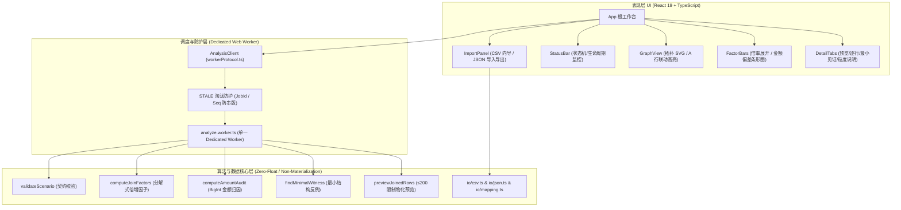

# 倍行镜 JoinWitness — 架构设计与集成契约文档 (ARCHITECTURE)

> **版本：** 1.0.0  
> **项目代号：** P008 (JoinWitness)  
> **更新阶段：** P008-T014 全流程序集成与契约联调  
> **遵循规范：** `01_project_book/PROJECT_BOOK.md` §1—§12、`02_implementation_plan/IMPLEMENTATION_PLAN.md`

---

## 1. 系统架构总览 (System Architecture Overview)

倍行镜 JoinWitness 是一款面向专业数据分析员与分析工程师的纯前端、离线、零数据外泄实验工作台。其核心目标在于解决 SQL `LEFT JOIN` 在一对多或多对多拓扑下无声倍增（Fanout）导致的聚合指标失真问题，并提供具有数学严格证明的最小反例见证集（Minimal Structural Witness）。

系统整体架构严格遵循“**UI 视图与交互 ⇄ Web Worker 隔离调度 ⇄ 纯数学/IO 核心**”三层分层模式：



---

## 2. 核心架构设计原则

### 2.1 零数据外泄保证 (Zero Network Exfiltration)
- **绝对纯本地运算：** 无论是用户本地加载的 2 MiB CSV 文件，还是导出的 JSON 场景，所有数据均常驻浏览器内存与 Dedicated Web Worker 堆栈中。
- **零外部请求：** 系统内绝不调用 `fetch`、`XMLHttpRequest`、`navigator.sendBeacon` 或 WebSocket 向外部服务端或大模型 API 发送任何业务数据。测试集通过 `tests/worker/worker.test.ts` 进行全局 fetchSpy 拦截断言，确保请求数为 0。

### 2.2 唯一 Dedicated Web Worker 与单例调度 (Singleton Worker)
- **单一 Worker 约束：** 系统在整个生命周期内仅维持一个 Dedicated Web Worker 实例（`analyze.worker.ts`），绝不产生嵌套 Worker 或并发多 Worker 争抢 CPU 资源。
- **环境自适应支持：** 在标准浏览器中通过原生 `new Worker(new URL('./analyze.worker.ts', import.meta.url), { type: 'module' })` 创建；在 Node.js / SSR / Vitest 环境中自动回退至同态结构克隆进程内模拟，确保 SSR 与单元测试 100% 稳定运行。

### 2.3 状态机与 STALE 淘汰防护机制 (State Machine & Stale Eviction)
系统严格实现项目书 §4 定义的客户端操作状态流转：

$$\text{IDLE} \longrightarrow \text{VALIDATING} \longrightarrow \text{RUNNING} \longrightarrow \text{COMPLETE} \mid \text{ERROR}$$

- **参数变更即失效：** 当分析员切换预设（如 JW-A → JW-B）、导入自定义 CSV/JSON 或修改映射参数时，立即调用 `markStale()`：
  1. 立即清除上一次计算生成的 `Audit` 成果（防止旧图表伪装为新输入的结果）；
  2. 客户端状态立即转为 `STALE`，状态栏显式呈现“已过期 (STALE)”黄色告警；
  3. 待处理队列中的挂起 Worker 请求立即以 `isStale: true` 标记终止；
  4. 即使因网络波动或线程调度导致早前旧任务延后完成，其响应也会因 `seq < latestDispatchedSeq` 或 `jobId !== latestDispatchedJobId` 被严格丢弃，从数学上杜绝“异步串版”风险。

### 2.4 非物化倍行计算保证 (Non-Materialization Guarantee)
- **避免笛卡尔积内存爆炸：** 真实数据库在双支路 JOIN 时展开行数可达数千亿行（例如 $10^5 \times 10^5 = 10^{10}$）。倍行镜通过分解式乘积算法计算 $f(a) = \beta_1(a) \times \beta_2(a)$（星型拓扑）或累加式级联算法 $f(a) = \sum \gamma(b)$（链式拓扑），无需物化全量笛卡尔积。
- **预览截断解耦 (U06 / FR06)：** 连接物化预览仅取前 $\le 200$ 行投影片段，而总行数、基表安全总额、朴素错误总额和差额 $\Delta$ 均基于全量数据独立精确计算，两者彻底解耦。

### 2.5 BigInt 纯整数分金额归因 (Zero-Float Guarantee)
- **杜绝 IEEE-754 浮点数陷阱：** 所有金额均严格表示为整数分（cents）字符串，如 `"50.00"` 元表示为 `"5000"` 分。
- **BigInt 运算：** 算法内核中的安全总额 $\text{safeSum}$、朴素总额 $\text{naiveSum}$ 与失真差额 $\Delta$ 全部使用 ECMAScript 原生 `BigInt` 进行加减乘除计算，序列化输出前纯字符串格式化，保证 38 位极大数值无任何精度损失。

---

## 3. 模块契约与职责映射表 (Contract Mapping)

| 模块文件 | 阶段任务 | 核心职责与接口契约 | 验收依赖与保证 |
|---|---|---|---|
| `src/core/types.ts` | T002 | 冻结 Scenario、Audit、Layout (`single`, `star`, `chain`) 类型与错误码 | 契约不可变基础 |
| `src/core/validate.ts` | T002 | 严格校验 Scenario 结构、布局约束、ID 格式与金额分规范 | 阻止任何畸变输入 |
| `src/core/factor.ts` | T003 | 分解式倍增因子计算，星型乘法、链式累加与 SQL NULL 孤立规则 | MATH01—04 确定性算法 |
| `src/core/amount.ts` | T004 | 基于 BigInt 的金额求和、朴素求和、差额计算与失真排序 | MATH01—03, MATH08 精度 |
| `src/core/witness.ts` | T005 | 最小结构反例见证集生成（JW-A 为 3 行，JW-F 为 4 行），非零金额偏好 | MATH06 理论下界证明 |
| `src/oracle/bruteforce.ts` | T006 | 独立暴力枚举 Oracle，1,000 组随机用例交叉比对 | MATH07 独立红队审查 |
| `src/core/scale.ts` | T007 | 1250 亿行非物化压力测试与 15,000 行边界性能测试 | MATH09 内存防 OOM |
| `src/io/csv.ts` | T008 | RFC4180 CSV 严格解析、BOM 过滤与纯 BigInt parseAmountToCents | FR02 格式兼容性 |
| `src/io/mapping.ts` | T008 | CSV 列映射与多表组装，严格保持行序与空值转 NULL | FR02 映射契约 |
| `src/io/json.ts` | T009 | joinwitness.scenario/v1 规范键序序列化、BOM 剥离与安全文件名 | FR03/11 往返保真 |
| `src/workers/analyze.worker.ts` | T010 | Dedicated Web Worker 运行时，离线纯内存异步计算 | FR09 隔离计算 |
| `src/workers/workerProtocol.ts` | T010 | AnalysisClient 单例管理、STALE 过期保护与请求废弃队列 | FR09 防串版防护 |
| `src/ui/GraphView.tsx` | T012 | 2/3 表连接拓扑 SVG 渲染、连线动画、A 行联动高亮与减少动态支持 | U01—U04 拓扑直观化 |
| `src/ui/FactorBars.tsx` | T012 | 倍率条形进度图、正负差额标示、键盘焦点访问与无障碍替代内容 | U01—U05 归因条形图 |
| `src/ui/DetailTabs.tsx` | T013 | 4 维度标签页：原始与预览表、逐行审计、最小反例见证集、粒度安全剖析 | FR06—FR08 证据呈现 |
| `src/ui/ImportPanel.tsx` | T014 | 导入导出交互面板、CSV 字段映射向导、基表声明与本地导入标记 | FR01, FR03 用户流程 |
| `src/ui/StatusBar.tsx` | T014 | 实时引擎状态监控条 (IDLE / RUNNING / COMPLETE / STALE / ERROR) | U01 操作反馈 |
| `src/ui/App.tsx` | T014 | 顶层应用全流程集成：真实 Worker 流水线驱动、参数变动清空机制 | FR01—FR12 全流程贯通 |
| `src/main.tsx` | T014 | 生产入口挂载，挂接真实 UI 与 CSS 样式 | 浏览器真实启动 |

---

## 4. 黄金预设场景验证基准 (Golden Benchmarks)

| 预设场景编号 | 拓扑布局 | 基表行数 | 展开总行数 | 安全总额 (元) | 朴素总额 (元) | 失真差额 $\Delta$ (元) | 最小见证集 | 核心测试点 |
|---|---|---|---|---|---|---|---|---|
| **JW-A** | star (星型双支路) | 3 | 8 | 86.00 | 284.00 | +198.00 | 3 行 (`o1`, `i11`, `i12`) | 双支路笛卡尔积暴增 |
| **JW-B** | chain (链式级联) | 2 | 6 | 37.00 | 157.00 | +120.00 | 3 行 (`a1`, `b1`, `b2`) | 链式累加（非星型误乘） |
| **JW-C** | single (负额抵消) | 2 | 4 | 0.00 | 0.00 | +0.00 | 3 行 (`x`, `bx1`, `bx2`) | $\Delta=0$ 但不安全基表行=2 |
| **JW-D** | single (SQL NULL) | 2 | 2 | 19.00 | 19.00 | +0.00 | NONE | NULL 互不相连 (SQL = 语义) |
| **JW-E** | single (无倍行) | 2 | 2 | 24.00 | 24.00 | +0.00 | NONE | 单表左连接无重复 |
| **JW-F** | chain (单边级联) | 1 | 2 | 10.00 | 20.00 | +10.00 | 4 行 (`a`, `b`, `c1`, `c2`) | 链式中间边理论下界 |

---

## 5. 构建与可重现验收命令

项目在 Linux 环境下具备 100% 独立可重现性：

```bash
# 1. 干净安装锁版本依赖
npm ci

# 2. 静态严格类型检查
npm run typecheck

# 3. 核心算法、Oracle 交叉比对与 UI 回归测试 (16 文件 277 用例)
npm run test

# 4. Vite 生产构建与 Dedicated Worker 分块编译
npm run build

# 5. 启动本地预览并在真实 Chromium 浏览器中执行全流程验收
npm run preview -- --host 127.0.0.1 --port 4173
```
